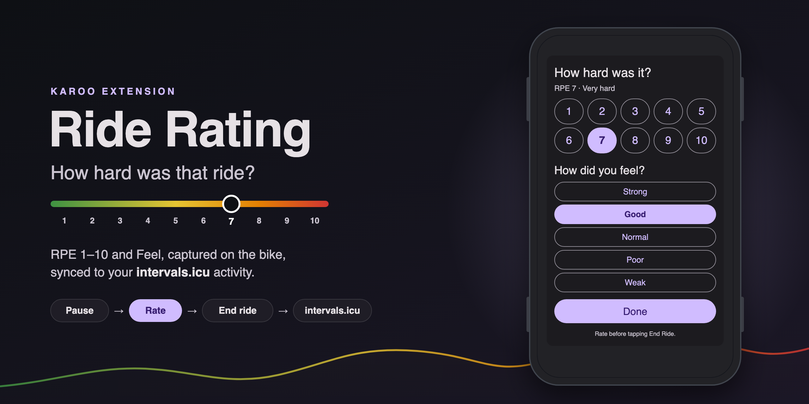

<p align="center">
  
</p>

# Ride Rating (RPE) for Karoo

A [Hammerhead Karoo](https://www.hammerhead.io/) extension that asks how hard a ride felt, using
**RPE (1–10)** and **Feel (Strong … Weak)**, and puts the answer on your
[intervals.icu](https://intervals.icu) activity.

Garmin head units ask "How did it feel?" after every ride and store the answer in the FIT file,
and intervals.icu, TrainingPeaks and others use it for load and fatigue tracking. Karoo has no
such prompt. This extension adds one.

## Features

- **In-ride data field** showing the current rating (`7 · Good`), or an orange *Tap to rate*
  until you've rated. Tap it to open the picker.
- **Pause prompt.** A Control Center notification ("How hard was this ride?") appears when you
  pause manually and haven't rated yet. Auto-pauses never trigger it.
- **intervals.icu sync.** After the ride ends, the extension waits for the upload to appear on
  intervals.icu and then sets `icu_rpe` and `feel` on that activity. It uses the Karoo's own
  connection (Wi-Fi, or the phone over Bluetooth), so no phone app is needed.
- **FIT developer fields.** The rating is also written into the ride's session message as
  `workout_rpe` (RPE × 10) and `workout_feel` (0 / 25 / 50 / 75 / 100), Garmin's names and scales.

## Usage

1. Install the APK (see below) and add the **Ride Rating** field to one of your ride pages.
2. Near the end of the ride, **pause**. Tap the notification, or the Ride Rating field.
3. Pick RPE and Feel, tap **Done**, then **End Ride**.

> [!IMPORTANT]
> **Rate before you tap End Ride.** The Karoo closes the FIT file when the ride ends, so a rating
> made afterwards is lost. You can change it as often as you like while the ride is open; the
> last value counts.

After the ride, the rating is queued. The Karoo checks intervals.icu with backoff (30 s,
doubling to 10 min) until it finds the uploaded activity: device "Karoo", start time within
5 minutes of the ride's start. It then sets RPE and Feel and posts a notification. It gives up
12 hours after the ride. The picker shows the last sync result.

| Feel   | FIT `workout_feel` | intervals.icu `feel` |
|--------|-------------------:|---------------------:|
| Strong | 100                | 1                    |
| Good   | 75                 | 2                    |
| Normal | 50                 | 3                    |
| Poor   | 25                 | 4                    |
| Weak   | 0                  | 5                    |

## Why the API, not just the FIT file?

Ideally the extension would write Garmin's *native* session fields 192/193 and every platform
would import them. Current Karoo firmware can't do that: it writes unknown native fields as
invalid field 255 and drops the `native_field_num` hint on developer fields. This is reported as
[hammerheadnav/karoo-ext#94](https://github.com/hammerheadnav/karoo-ext/issues/94), with details
in [`docs/karoo-ext-issue-draft.md`](docs/karoo-ext-issue-draft.md).

Until that's fixed, platforms ignore the developer fields, so the extension also sets the rating
through the intervals.icu API.

## Setup

### intervals.icu API key

Sync needs your personal API key (intervals.icu → *Settings* → *Developer Settings*). Put it in a
`.env` file at the repo root (git-ignored):

```
INTERVALS_ICU_API_KEY=your-key-here
```

The key is compiled into **debug builds only**. Release builds never contain it and have sync
turned off; they only write the FIT developer fields.

> [!WARNING]
> A debug APK built with your key contains that key. Don't share it or publish it.

### Build

Requires JDK 17. The Karoo SDK (`io.hammerhead:karoo-ext`) comes from GitHub Packages, so add a
GitHub token with `read:packages` to `~/.gradle/gradle.properties`:

```properties
gpr.user=<your GitHub username>
gpr.key=<token with read:packages>
```

Then:

```sh
export JAVA_HOME=$(/usr/libexec/java_home -v 17)   # macOS
./gradlew :app:testDebugUnitTest
./gradlew :app:assembleDebug
# → app/build/outputs/apk/debug/karoo_rpe-<version>-debug.apk
```

### Install

With the Karoo connected over USB (developer mode on):

```sh
adb install -r app/build/outputs/apk/debug/karoo_rpe-*-debug.apk
```

## How it works

| Component | Role |
|-----------|------|
| [`RideRating`](app/src/main/kotlin/com/karoo_rpe/extension/RideRating.kt) | Rating model and FIT field mapping. Pure, no I/O. |
| [`RideRatingCoordinator`](app/src/main/kotlin/com/karoo_rpe/extension/RideRatingCoordinator.kt) | Pure flows over ride state and rating: session writes, pause prompts, ride start/end events. |
| [`RideRatingRepository`](app/src/main/kotlin/com/karoo_rpe/data/RideRatingRepository.kt) | DataStore shared by the picker and the extension service: current rating, ride start, pending sync, sync status. |
| [`IntervalsSync`](app/src/main/kotlin/com/karoo_rpe/sync/IntervalsSync.kt) | intervals.icu request building, activity matching and retry loop, with HTTP injected. |
| [`RpeExtension`](app/src/main/kotlin/com/karoo_rpe/extension/RpeExtension.kt) | Wires it all to the Karoo: `WriteToSessionMesg`, notifications, sync on ride end. |
| [`RateRideActivity`](app/src/main/kotlin/com/karoo_rpe/RateRideActivity.kt) | Compose picker. Also the launcher and extension-settings entry point. |

FIT writes are driven by rating *changes* (not elapsed time, which stops while paused). Karoo
keeps the last values written and puts them in the final session message.

### Checking the FIT output

```sh
adb pull <path-to-ride>.fit ride.fit
pip install fitdecode
python -c "import fitdecode
for f in fitdecode.FitReader('ride.fit'):
    if isinstance(f, fitdecode.FitDataMessage) and f.name == 'session':
        print({k: f.get_value(k) for k in ('workout_rpe', 'workout_feel') if f.has_field(k)})"
```

For RPE 7 / Good, expect `{'workout_rpe': 70, 'workout_feel': 75}`.

## Compatibility

Tested on a Karoo 3 (ROM 1.665) with karoo-ext 1.1.7. Karoo 2 should work too (min SDK 26) but
is untested.

## License

[MIT](LICENSE)
